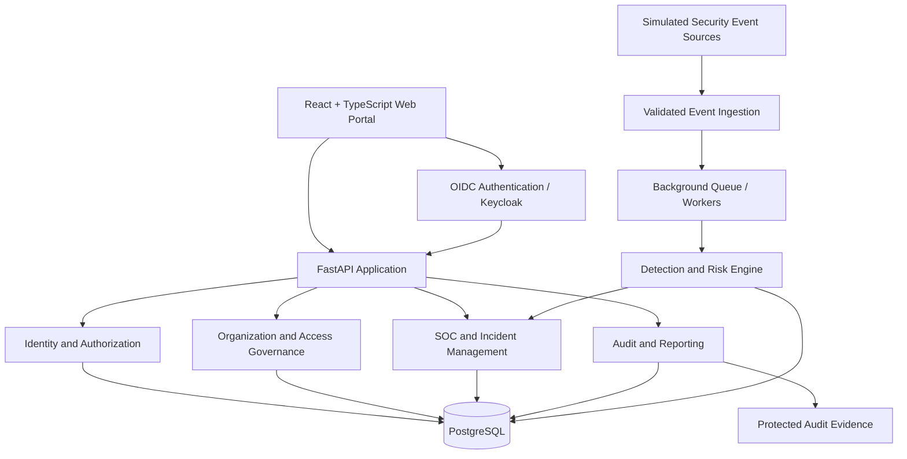

# BankShield Enterprise

## Enterprise Banking Security & Identity Governance Platform


> **Project status: Planning and repository organization.** The repository contains initial documentation and a project-management workbook. The application, integrations, automated tests, and dashboards described below are **planned**, not yet implemented. Badges are descriptive and do not imply passing builds or deployed functionality.

Repository: https://github.com/rwetaka-art/bankshield-enterprise
Project type: Independent cybersecurity engineering portfolio project
Reference environment: Nile Horizon Bank Uganda, a fictional commercial bank
Intended audience: Identity and Access Management (IAM), Security Operations Center (SOC), security engineering, IT risk, and banking cybersecurity teams

## Table of Contents


## Overview


## Problem Statement and Objectives


## Implementation Status


## Platform Modules


## Architecture


## Technology Stack


## Repository Structure


## Identity, Roles, and Permissions


## Security Controls


## Threat Detection and Risk Analytics


## Development Roadmap


## Installation and Local Development


## Testing and Quality Assurance


## Screenshots and Demonstrations


## Portfolio Interview Walkthrough


## Project Management


## Data Privacy and Ethical Use


## Contributing


## License


## Overview

BankShield Enterprise is a planned, security-first web platform for managing employee identities, governing access privileges, monitoring authentication and access events, investigating suspicious activity, and producing audit-ready security evidence in a simulated banking environment.
The platform will model multiple branches, departments, employee roles, and enterprise applications. It is intended to demonstrate how identity governance, threat detection, and incident response can work together in a single operational workflow.
BankShield is not a core banking system: it will not handle real customer deposits, transfers, loans, or payments. It is a security and identity-governance platform using fictional organizational data and simulated security events.

**Independence notice:** BankShield is not affiliated with, endorsed by, or deployed at Bank of Africa Uganda Ltd or any other financial institution. The fictional bank and its operational details are illustrative.


## Problem Statement and Objectives


Financial institutions need to answer questions such as:

- Who has access to which systems, and is that access still justified?
- Can an employee view records outside their approved branch or department?
- Are privileged accounts being used in unexpected ways?
- Do authentication and device signals suggest credential misuse or account compromise?
- Which users or departments are being targeted by phishing or authentication attacks?
- Can security analysts trace an alert to supporting evidence and document a response?
- Can auditors review access decisions and sensitive administrative activity?

### Project objectives


| Objective | Proposed acceptance criterion |
| --- | --- |
| Identity lifecycle | Manage at least 100 fictional employee profiles |
| Organizational modeling | Represent at least 8 departments and 4 fictional branches |
| Access governance | Enforce role, branch, and record-level permissions on the server |
| Threat monitoring | Implement at least 10 testable detection rules |
| Risk analytics | Produce explainable user risk scores with contributing evidence |
| Incident management | Support alert triage, assignment, investigation, and closure |
| Auditability | Record sensitive changes and preserve protected audit evidence |
| Engineering quality | Automate critical positive and negative security tests |
| Portfolio readiness | Demonstrate a complete security investigation in 8–10 minutes |

These are targets, not measured outcomes.

## Implementation Status


| Component | Status | Notes |
| --- | --- | --- |
| GitHub repository | Established | Public repository and main branch exist |
| Initial folder structure | Established | Documentation placeholders created |
| Project WBS workbook | Uploaded | Master planning spreadsheet currently at repository root |
| Root README | Being updated | This document is the proposed replacement |
| Database and migrations | Not started | PostgreSQL schema is planned |
| Identity provider integration | Not started | Keycloak/OIDC planned |
| Backend API | Not started | FastAPI planned |
| Frontend dashboard | Not started | React/TypeScript planned |
| Detection and risk engine | Not started | Rules and scoring planned |
| Incident workflows | Not started | SOC case management planned |
| CI/CD and automated tests | Not started | GitHub Actions and test suites planned |
| Deployment | Not available | No runnable release or public demo yet |

Status entries should be updated only after the corresponding deliverables are verified.

## Platform Modules


| ID | Module | Planned capabilities |
| --- | --- | --- |
| 01 | Identity & User Lifecycle | Onboarding, employee transfers, suspension, termination, provisioning, and deprovisioning |
| 02 | Role-Based Access Control (RBAC) | Roles, permissions, branch/record scope, access requests, and separation of duties |
| 03 | Department & Branch Management | Departments, branches, reporting lines, managers, and organizational access boundaries |
| 04 | Cyber Threat Monitoring | Authentication anomalies, password spraying, phishing indicators, and unauthorized access attempts |
| 05 | Credential Misuse Analytics | Suspicious overlapping sessions, device changes, location inconsistencies, and account takeover signals |
| 06 | User Risk Scoring | Explainable event-based scores, risk history, severity thresholds, and supporting evidence |
| 07 | Privileged Access Governance | Elevated role requests, approvals, time-bound access, privileged activity, and recertification |
| 08 | SOC Incident Management | Alert triage, evidence, assignment, escalation, investigation timeline, and case closure |
| 09 | Audit & Compliance Reporting | Access reviews, audit logs, evidence exports, retention controls, and policy exceptions |
| 10 | Executive Security Dashboard | Enterprise posture, branch and department trends, open incidents, and governance KPIs |

### Planned end-to-end scenario

A fictional teller signs in and attempts an operation outside their authorized branch. The API denies access and records an event. Additional simulated suspicious logins trigger a detection rule, raising the employee's risk score. A SOC analyst reviews the evidence, creates an incident, documents a decision, and produces an audit report.

## Architecture


### Proposed high-level architecture




Architecture approach: Begin with a modular monolith and asynchronous background processing. Services can be separated later if scale or operational needs justify it. The diagram is a design proposal, not a deployed architecture.

### Planned processing flow

- An identity provider or synthetic event generator emits a security event.
- The ingestion layer validates the source, schema, event time, and identifiers.
- The event is stored and processed by configurable detection rules.
- Matching rules generate alerts and contribute to explainable risk scores.
- An authorized analyst reviews evidence and opens or updates an incident.
- Sensitive actions and decisions are captured in protected audit records.

## Technology Stack


| Layer | Planned technology | Purpose |
| --- | --- | --- |
| Frontend | React, TypeScript, Tailwind CSS | Responsive, role-specific portal |
| Backend | Python, FastAPI, Pydantic | APIs and business services |
| Database | PostgreSQL | Structured operational and security data |
| ORM and migrations | SQLAlchemy, Alembic | Schema evolution and data access |
| Identity provider | Keycloak | OIDC authentication and MFA |
| Authorization | Server-side RBAC + attribute constraints | Least privilege and branch scoping |
| Background processing | Celery, Redis | Asynchronous event handling |
| Security analytics | Python rules; optional Wazuh/OpenSearch | Event correlation and investigation |
| Charts | Recharts | Security and governance dashboards |
| Testing | Pytest, Playwright | Unit, integration, and browser tests |
| Security scanning | Semgrep/Bandit, Trivy, OWASP ZAP | Static, dependency, container, and web testing |
| Containers | Docker Compose | Repeatable local environment |
| CI/CD | GitHub Actions | Automated verification |
| Hosting | To be determined | Controlled demo deployment |

Technology choices may change after architecture validation.

## Repository Structure


```text
bankshield-enterprise/
├── frontend/                 # Planned React/TypeScript portal
├── backend/                  # Planned FastAPI services
├── database/                 # Planned migrations and schema
├── security/                 # Planned detection rules and risk analytics
├── infrastructure/           # Planned Docker and deployment configs
├── tests/                    # Planned automated test suites
├── synthetic-data/           # Fictional test records and event fixtures
├── docs/
│   ├── architecture/         # Architecture and data-flow diagrams
│   ├── requirements/         # Functional and nonfunctional requirements
│   ├── project-management/   # WBS, Gantt, milestones, risks
│   └── security/             # Threat model and control documentation
├── .github/
│   └── workflows/            # Planned CI workflows
├── README.md
├── LICENSE
└── .gitignore
```

The repository folders currently contain planning placeholders; the descriptions above indicate their intended use.

## Identity, Roles, and Permissions

The fictional organization will include roles such as System Administrator, IAM Administrator, CISO, SOC Analyst, Branch Manager, Teller, Loan Officer, HR Officer, Compliance Officer, and Internal Auditor.
Authorization will combine:
- RBAC: What actions a role is allowed to perform.
- Contextual restrictions: Which branch, department, owner, or data classification the action applies to.
- Separation of duties: Preventing a requester from approving their own privileged access.
- Access lifecycle controls: Removing or reviewing access after transfers, suspension, and termination.
All access checks must be enforced by the backend. Hiding buttons in the frontend is not sufficient authorization.

## Security Controls


The platform design includes:

- OIDC-based authentication, with MFA for privileged accounts.
- Deny-by-default server-side authorization and least privilege.
- Branch and record-level authorization checks.
- Protected secrets, TLS, and encryption at rest where applicable.
- Rate limits, input validation, and safe error handling.
- Auditable privileged role assignments and approval workflows.
- Tamper-evident audit records and separately protected evidence storage.
- Controlled access to incident evidence and configurable retention.
- Structured event logging with correlation identifiers.
- Human approval for sensitive response actions.
- Read-only AI-assisted investigation summaries, if added, with evidence grounding and prompt-injection safeguards.
Credential-sharing detection is probabilistic: suspicious sessions are indicators for investigation, not proof that an employee shared credentials. Passwords, session tokens, and other secrets must never be collected for this purpose.

## Threat Detection and Risk Analytics


The first planned detection catalog includes:


| Rule | Detection |
| --- | --- |
| DET-001 | Repeated failed authentication attempts |
| DET-002 | Password spraying across multiple accounts |
| DET-003 | Suspicious overlapping sessions |
| DET-004 | Geographic login inconsistency, accounting for VPNs |
| DET-005 | Unauthorized privilege changes |
| DET-006 | Repeated restricted-resource access attempts |
| DET-007 | Simulated phishing targeting and user interaction |
| DET-008 | Unusual access hours relative to baseline |
| DET-009 | Dormant account reactivation |
| DET-010 | Unusual bulk access or export patterns |

Risk scores will expose contributing events, rule identifiers, timestamps, and severity. Scores will be calibrated using synthetic scenarios and tested for false positives. They must not be used as automatic proof of misconduct.

## Development Roadmap


| Phase | Planned deliverables | Status |
| --- | --- | --- |
| 1. Requirements and design | SRS, architecture, threat model, WBS, acceptance criteria | Planning |
| 2. Identity foundation | Keycloak, employees, branches, roles, permissions | Not started |
| 3. Security event pipeline | Validated event ingestion, persistence, synthetic event generator | Not started |
| 4. Detection and risk | Detection rules, alerts, explainable scores | Not started |
| 5. SOC workflows | Cases, analyst assignment, evidence, escalation | Not started |
| 6. Privileged access governance | Approval workflows, temporary elevation, access reviews | Not started |
| 7. Reporting and optional AI | Dashboards, exports, read-only incident summaries | Not started |
| 8. Hardening and release | Security testing, documentation, deployment, demo | Not started |

The detailed schedule, dependencies, task owners, and progress measures are maintained in the Excel WBS workbook. Dates are planning estimates and may change.

## Installation and Local Development

There is currently no runnable application release. The folders are organized, but backend, frontend, database services, and container configurations have not yet been implemented. The commands below are future workflow examples, not working setup instructions today.

### Planned prerequisites

- Git
- Python 3.12 or a tested supported version
- Node.js LTS and npm
- Docker Desktop with Docker Compose
- A code editor such as VS Code

### Planned local workflow (after implementation)


```bash
# Clone the repository
git clone https://github.com/rwetaka-art/bankshield-enterprise.git
cd bankshield-enterprise

# Future command once infrastructure/compose.yaml exists:
# docker compose -f infrastructure/compose.yaml up --build
```

Do not expect the commented Docker command to work until the Compose file, environment template, migrations, and services are added. Configuration values will be documented in a safe `.env.example`; real secrets must never be committed.

## Testing and Quality Assurance


### Planned test coverage


| Test area | Example acceptance test |
| --- | --- |
| Authentication | Expired or invalid tokens are rejected |
| Authorization | Teller cannot access auditor-only API |
| Branch isolation | Manager cannot read another branch's restricted records |
| Separation of duties | User cannot approve own privileged request |
| Identity lifecycle | Terminated employee loses active access |
| Detection | Configured failed-login threshold creates an alert |
| Evidence integrity | Unauthorized audit modification is rejected or detected |
| Risk analytics | Scores and contributing signals are reproducible |
| Incident workflow | Analyst can create, assign, and close a case with evidence |
| AI safety | Malicious text in event evidence cannot trigger privileged actions |
| Performance | Measured latency and concurrency targets are documented |
| Recovery | Backups restore successfully with integrity checks |

Initial quality target: At least 100 meaningful automated tests, with particular emphasis on negative authorization tests. This is a target, not a current test count.
Planned CI checks include formatting, linting, type checks, unit tests, integration tests, secret scanning, and dependency vulnerability scanning. No passing CI badge will be displayed until a workflow exists and succeeds.

## Screenshots and Demonstrations

Screenshots will be added after the corresponding screens exist. The following are placeholders, not evidence of implemented features.

| Planned screenshot | Intended content |
| --- | --- |
| `docs/screenshots/security-overview.png` | Enterprise risk and alerts dashboard |
| `docs/screenshots/identity-management.png` | Employees, branches, departments, roles |
| `docs/screenshots/access-review.png` | Access requests and approval workflow |
| `docs/screenshots/alert-investigation.png` | Detection evidence and case timeline |
| `docs/screenshots/audit-report.png` | Protected audit and compliance reporting |

Demo video: To be added after the MVP is functional.

## Portfolio Interview Walkthrough

A planned 8–10 minute demonstration will show:
- Business context: Explain the bank's identity and security monitoring problem.
- Identity governance: Provision a fictional employee and assign an approved role.
- Access enforcement: Demonstrate a denied cross-branch API request.
- Threat simulation: Generate synthetic authentication anomalies.
- Detection and risk: Inspect the alert, detection rule, and risk factors.
- SOC response: Assign an analyst, document evidence, and close an incident.
- Auditability: Show who approved actions and how evidence is protected.
- Engineering practices: Review architecture, tests, threat model, and CI results.
The demonstration will clearly separate working capabilities from future plans.

## Project Management

The repository includes a master Excel work breakdown structure containing a dashboard, detailed tasks, Gantt chart, milestones, roles/RACI, requirements, risk register, and usage instructions.
Current location: The workbook was initially uploaded at the repository root under a filename beginning `BankShield_Enterprise_Complete_WBS_Dashboard_Gantt`. It is intended to move to `docs/project-management/` after verification.
GitHub Issues and Projects are planned for day-to-day execution. The Excel WBS remains the scheduling baseline until an explicit synchronization workflow is established.

## Data Privacy and Ethical Use

All data must be synthetic. Use fictional employee identities, branches, customers, devices, login events, phishing scenarios, and incident records. Do not upload real bank data, credentials, API keys, private employee information, or production logs.
This project is intended for authorized defensive security education and portfolio demonstration. It must not be represented as a real bank deployment, compliance certification, or proven detection product.

## Contributing

This repository is currently maintained as an independent portfolio project. Contributions and suggestions may be proposed through GitHub Issues or pull requests when those workflows are configured.
Before contributing, avoid committing secrets, sensitive data, or unlicensed proprietary materials. Changes to authorization, security rules, and audit behavior should include appropriate tests and documentation.

## License

This repository includes an MIT License. The license applies to original material covered by that file. Third-party dependencies, artwork, trademarks, and referenced documentation retain their respective licenses and rights.

---


*BankShield Enterprise — Security-first identity governance for a fictional banking environment.*
